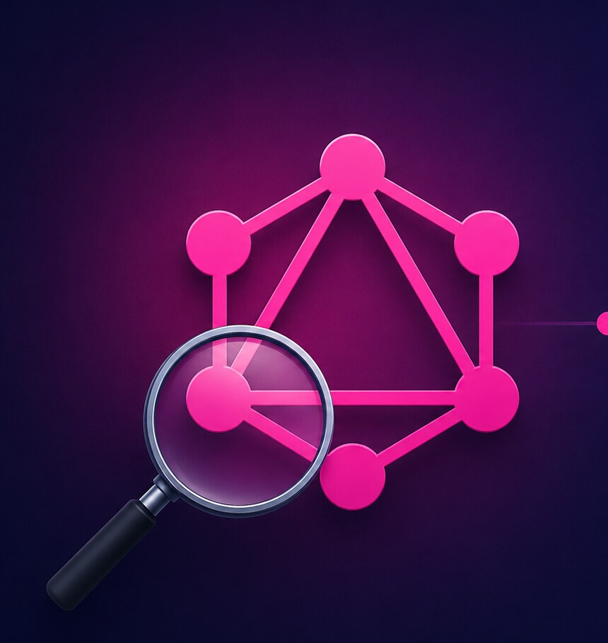
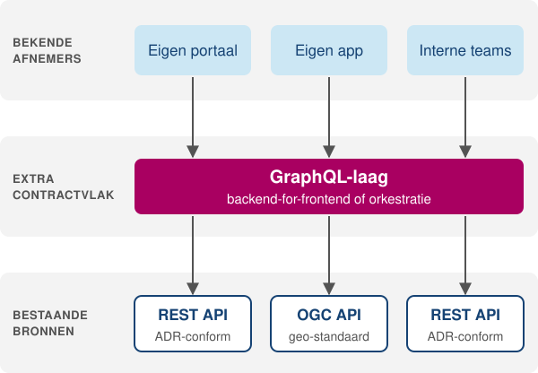

<!-- _class: title -->

# GraphQL onder de loep

## Een afwegingskader voor GraphQL en REST

**Joost Farla** · Kennisplatform API's · 4 november 2026

<!--
- Gebaseerd op de blogserie van vier delen op developer.overheid.nl (juli tot september).
- Opbouw: ongeveer 25 minuten verhaal, daarna discussie.
- Belofte vooraf: geen pleidooi voor of tegen GraphQL. Een afwegingskader.
≈0:00
-->

---

## Waarom dit onderwerp

- GraphQL komt regelmatig voorbij in gesprekken over API's binnen de overheid
- Internationaal breed ingezet, onder meer door **GitHub**, **Shopify** en **Netflix**
- Binnen de Nederlandse overheid **nauwelijks zichtbaar**

<div class="highlight">
Twee vragen voor vandaag: hoe weeg je GraphQL en REST tegen elkaar af, en heeft het Kennisplatform hier een rol?
</div>

<!--
- GraphQL komt steeds terug: organisaties experimenteren ermee, vragen bij developer.overheid.nl.
- Internationaal in productie: GitHub en Shopify bieden er publieke API's mee aan, Netflix draait er intern op.
- Hier nauwelijks zichtbaar. Wat de ADR en het API-register daarover zeggen, komt later terug.
- Daarom grondig kijken, zonder vooraf ingenomen standpunt.
- Die twee vragen komen aan het eind terug in de discussie.
≈0:30
-->

---



## Agenda

1. Kennismaking: een ander model
2. Wat GraphQL oplevert: flexibiliteit en een contract
3. Wat GraphQL vraagt: limieten, caching en conventies
4. Afwegen: zeven factoren en de overheidscontext
5. Discussie

<!--
- De eerste vier blokken volgen grofweg de vier blogdelen: kennismaking tot ongeveer 7:00, oplevert en vraagt tot 17:00, afwegen tot ongeveer 25:00.
- Discussie: ongeveer 15 minuten, met een paar open vragen aan het Kennisplatform.
≈1:45
-->

---

<!-- _class: tight -->

## Het schema is een graph, het antwoord spiegelt de query

<p class="lead">Querytaal, schemataal en runtime · Facebook 2012, open source 2015 · GraphQL Foundation (Linux Foundation) sinds 2018</p>

<div class="cols">
<div>

```graphql
type Organisatie {
  id: ID!
  naam: String!
  apis: [Api!]!
}

type Api {
  id: ID!
  titel: String!
  versie: String!
  organisatie: Organisatie!
}

type Query {
  organisatie(id: ID!): Organisatie
  apis: [Api!]!
}
```

</div>
<div>

```graphql
{
  organisatie(id: "min-bzk") {
    naam
    apis { titel versie }
  }
}
```

```json
{
  "data": {
    "organisatie": {
      "naam": "Ministerie van BZK",
      "apis": [
        { "titel": "Adressenregister API",
          "versie": "2.1.0" }
      ]
    }
  }
}
```

</div>
</div>

<!--
- Eerst de basis, kort: drie dingen in één (querytaal, schemataal SDL, runtime), ontstaan bij Facebook.
- Governance is neutraal (Linux Foundation) en de spec beweegt weer: de September 2025 Edition is de eerste nieuwe editie sinds oktober 2021.
- Introspectie: de API is zelfbeschrijvend. Basis voor GraphiQL, documentatie en codegeneratie. Mutations en subscriptions bestaan; vandaag gaat het over bevragen.
- Voorbeeld losjes gebaseerd op het API-register.
- Uitroepteken: verplicht veld. Let op de relaties: een organisatie heeft API's, een API verwijst terug. Vandaar "graph".
- Rechts: de client vraagt de naam en per API titel en versie, en krijgt precies dat terug. Niets meer, niets minder.
- In de praktijk benoemde operaties met variabelen: een herbruikbaar document dat de server vooraf kan controleren. Onthouden: dat is straks de basis voor persisted queries.
≈2:15
-->

---

## Dezelfde vraag in REST

```http
GET /organisaties/min-bzk
GET /organisaties/min-bzk/apis
```

- **Overfetching**: de volledige organisatie, inclusief velden die je hier niet nodig hebt
- **Underfetching**: geeft de tweede call alleen samenvattingen, dan is per API nog een call nodig
- REST kan hetzelfde bereiken: met parameters als `fields` of `expand`, of met een endpoint
  toegesneden op een informatie-behoefte

<div class="highlight">
<strong>REST</strong>: de aanbieder ontwerpt vooraf welke antwoorden er zijn.<br><strong>GraphQL</strong>: de client stelt het antwoord samen, binnen het schema.
</div>

<!--
- Dit is het probleem waarvoor GraphQL bij Facebook is ontworpen: mobiele apps, trage netwerken, een nieuwsfeed vol diep geneste data. Eén request, één roundtrip, precies de benodigde data.
- REST kan dit ook: sparse fieldsets, expand, toegesneden endpoints.
- GraphQL biedt die flexibiliteit generiek; in REST ontwerp je haar per geval. Dat is de eerste helft van de rode draad.
- Onthouden: in GraphQL kiest de client. Dat komt terug bij wat GraphQL vraagt: de client bepaalt ook de zwaarte.
≈4:15
-->

---

## Op HTTP-niveau: twee verschillende modellen

```http
POST /graphql
Content-Type: application/json

{ "query": "query Naam($id: ID!) { organisatie(id: $id) { naam } }",
  "variables": { "id": "min-bzk" } }
```

<div class="cols">
<div class="card rest">

### REST

- Modelleert **resources** en leunt op de **semantiek van HTTP**
- HTTP-methoden, statuscodes, een URI per resource, cache-headers, content negotiation
- Caches, proxies en gateways kunnen zinvol reageren op het verkeer

</div>
<div class="card gql">

### GraphQL

- Modelleert een **graph van types** en gebruikt HTTP vooral als **transport**
- Eén endpoint, vrijwel altijd `POST`, doorgaans&nbsp;`200 OK`
- De vraag staat in de body, onzichtbaar voor het netwerk; fouten komen als data in het antwoord

</div>
</div>

<!--
- Kijk naar het verkeer: één endpoint, POST, de eigenlijke vraag zit in de body.
- Voor het netwerk is elk GraphQL-request identiek.
- REST: het netwerk "begrijpt" de API. GraphQL: HTTP is vooral transport.
- Daarom past GraphQL ook niet in OpenAPI: die is gebouwd op het HTTP-model.
- Het transportgedrag ligt formeel nog niet vast: GraphQL over HTTP is een working draft.
- Dat is de tweede helft: wat REST van HTTP meekrijgt, regelt GraphQL zelf.
≈5:15
-->

---

<!-- _class: statement compact -->

Wat GraphQL **generiek** biedt,<br>ontwerp je in REST per geval.

Wat REST **van HTTP** meekrijgt,<br>organiseer je in GraphQL zelf.

<!--
- De twee helften samen: de rode draad van de serie. Vrijwel elk voordeel en elke uitdaging hierna is hierop terug te voeren. Eerst de eerste helft, daarna de tweede.
- Geen "betere REST" en geen "slechtere REST": een ander model, met verantwoordelijkheden op een andere plek.
- ZEG: "Het is een verschuiving, geen winst of verlies."
≈6:30
-->

---

## Wat GraphQL oplevert

<div class="cols cols-3">
<div class="card gql">

### Eén roundtrip

- Exact de benodigde data, ongeacht hoeveel types een vraag raakt
- Vooral merkbaar bij veel schermvarianten, trage netwerken en mobiele clients

</div>
<div class="card gql">

### Autonomie voor clientteams

- Een nieuw scherm is een nieuwe query op het bestaande schema
- Geen nieuw endpoint nodig, zolang de gegevens al in het schema staan

</div>
<div class="card gql">

### Eén schema over bronnen

- Resolvers verbergen waar de data staat: database, services of externe API's
- Basis voor een orkestratielaag boven bestaande bronnen, zonder die te vervangen

</div>
</div>

<!--
- Eerste helft van de rode draad: wat GraphQL generiek biedt.
- Technisch: één roundtrip, het probleem van de REST-slide.
- Organisatorisch: het frontend-team stelt zelf een query samen; de backend hoeft niet mee te bewegen zolang de gegevens al in het schema staan. In REST vervult een toegesneden endpoint of een backend-for-frontend die rol.
- Resolvers: elk veld wordt ingevuld door een functie. Waar de waarde vandaan komt, is onzichtbaar voor de client. Daarmee kan GraphQL een orkestratielaag zijn. Netflix gaat verder met federatie: elk team levert een deel van het schema, een router voegt die samen en stuurt elk deel van een query naar de service die het levert. Bij Netflix gaat het om ruim tweehonderd services. Niet te verwarren met het Federatief Datastelsel.
- Op dat laatste patroon komen we terug bij de overheidscontext.
≈7:00
-->

---

## Het schema als contract

<div class="cols">
<div class="card">

### Contract

- Validatie, codegeneratie en verkennen via introspectie, op basis van het schema
- In REST vervult **OpenAPI** die rol, als apart artefact: synchroon houden doe je met generatie of
  validatie
- In GraphQL valt het schema op typeniveau samen met de runtime: de server weigert elke query die er
  niet op past

</div>
<div class="card">

### Evolutie

- Velden krijgen `@deprecated` en blijven bestaan zolang clients ze gebruiken
- Elke client benoemt zijn velden: **gebruik is per veld en per afnemer meetbaar**
- REST faseert doorgaans per major versie uit, met een overgangsperiode

</div>
</div>

<div class="highlight">
Kanttekening: het schema draagt zijn verleden mee, en definitief verwijderen blijft in beide modellen een breaking change.
</div>

<!--
- Beide ecosystemen hebben een machineleesbaar contract; dat op zich onderscheidt ze niet. De ADR verplichten een OpenAPI-beschrijving.
- Verschil 1, waar het contract leeft: OpenAPI vraagt een bewuste keuze voor synchronisatie (met de hand, generatie uit code, codegen uit de spec, of validatie). Bij GraphQL zit die in de runtime.
- Verschil 2, feedback: OpenAPI kent ook deprecated, maar een REST-response bevat doorgaans de volledige representatie, dus je ziet niet welk veld werkelijk wordt gebruikt (tenzij met sparse fieldsets). Bij GraphQL zie je per afnemer welk veld nog gebruikt wordt.
- GraphQL groeit additief in één schema, omdat een tweede versie de hele graph zou dupliceren.
≈8:45
-->

---

## Wat GraphQL vraagt: de client bepaalt de zwaarte

<div class="cols cols-40">
<div>

```graphql
{
  apis {
    organisatie {
      apis {
        organisatie {
          apis { titel }
        }
      }
    }
  }
}
```

</div>
<div>

- Kosten: bij REST **per endpoint** voorspelbaar, bij GraphQL **per query** verschillend
- **N+1**: naïeve resolvers maken van 100 API's met hun organisatie 1&nbsp;+&nbsp;100
  databasequeries; batching of vertaling naar één SQL-query voorkomt dat
- Circulaire relaties: elk nestingniveau **vermenigvuldigt** het aantal records
- Ook REST kent dit risico (`expand`, grote pagina's), maar begrenst het in het ontwerp

</div>
</div>

<!--
- Tweede helft van de rode draad. Eerst kort: REST is niet gratis (endpoints ontwerpen, versies beheren, de OpenAPI-beschrijving synchroon houden), en die kosten kent dit publiek goed.
- Dit blok gaat over wat bij GraphQL anders is: de keerzijde van de flexibiliteit (zwaarte, limieten) en wat REST van HTTP meekrijgt (caching, conventies).
- Bij REST: een eindige set endpoints, per endpoint de queries, indexen en desnoods een read model. Bij GraphQL is de autonomie van zonet de bron van onvoorspelbaarheid.
- N+1: resolvers werken per veld; naïef haalt elke resolver zijn eigen gegevens op. Twee routes, elk met een keerzijde:
- Batching (DataLoader) bundelt per nestingniveau tot één WHERE id IN (...). Keerzijde: je richt het per relatie zelf in, en het blijft een query per niveau, geen join.
- Vertaling naar één SQL-query: Hasura en PostGraphile, of lookahead en projecties zoals bij HotChocolate met Entity Framework. Keerzijde: werkt alleen als de gegevens in één database staan, en het schema komt dicht op de database en het framework te liggen (zie de backup over filterdialecten). Voor een laag boven bestaande API's valt deze route dus af.
- Open bevragingsruimte: optimaliseren wordt reactief, en de belasting kan verschuiven met elke client-release.
- Geneste query: een organisatie heeft API's, een API heeft een organisatie. Een paar regels querytekst kan miljoenen rijen raken; voor een kwaadwillende een goedkope denial-of-service (OWASP).
- Ook REST: OWASP API4:2023 (unrestricted resource consumption) geldt net zo. Het verschil is dat REST het per endpoint begrenst.
≈10:30
-->

---

<!-- _class: small -->

## Limieten stellen: de beschikbare maatregelen

| Maatregel                | Wat het doet                                                                        |
| ------------------------ | ----------------------------------------------------------------------------------- |
| Depth en amount limiting | maximale nesting en lijstgrootte; een eenvoudige eerste verdedigingslinie           |
| Verplichte paginering    | geen onbegrensde lijsten: elk lijstveld een verplicht `first` met een maximum       |
| Query cost analysis      | gewicht per veld, totaal berekenen vóór uitvoering (IBM `@cost` en `@listSize`)     |
| Rate limiting op kosten  | een puntenbudget per afnemer in plaats van requests per minuut (Shopify, GitHub)    |
| Persisted queries        | alleen vooraf geregistreerde documenten; de client stuurt een hash                  |
| Basishygiëne             | timeouts, limieten op batching, introspectie afschermen waar de API niet publiek is |

<!--
- OWASP beschouwt deze maatregelen als basisinrichting, niet als optionele extra's.
- Cost analysis: een draft-specificatie van IBM; Apollo Demand Control bouwt erop voort.
- Rate limiting op kosten: één GraphQL-request kan het werk van honderd REST-requests doen. Ook REST-requests verschillen in kosten; GraphQL maakt dat alleen explicieter.
- Persisted queries (ook: trusted documents): de meest vergaande maatregel. Dit zijn de benoemde operaties met variabelen van het begin, nu vooraf geregistreerd. Er loopt een RFC om dit in GraphQL over HTTP te standaardiseren.
- Daarmee is de set bevragingen weer eindig. Dat relativeert de flexibiliteit; het verschil met REST-endpoints is dat clientteams de documenten zelf opstellen en de server ze registreert.
≈12:30
-->

---

## Caching: platform of ontwerpkeuze

<div class="cols">
<div class="card rest">

### REST

- Elke resource heeft een **unieke URI**
- `GET` met `Cache-Control` en `ETag`
- Elke CDN, proxy en browser kan ermee overweg, mits de aanbieder de headers correct zet

</div>
<div class="card gql">

### GraphQL

- Vrijwel altijd `POST` naar één endpoint: buiten bereik van HTTP-caches en CDN's
- Opties: `GET` voor queries, of **persisted queries met `GET`** (een korte hash in de URL, geschikt
  voor CDN-caching)
- Of caching in de client (Apollo Client, Relay) of per veld op de server

</div>
</div>

<div class="highlight">
Bij REST leunt caching op HTTP. Bij GraphQL kies en bouw je de cachingstrategie zelf.
</div>

<!--
- Nu wat REST van HTTP meekrijgt; caching is het duidelijkste voorbeeld.
- Minder zichtbaar, maar relevant voor wie op CDN-caching leunt, zoals veelbevraagde open-data-API's.
- Genormaliseerde caches in de client zijn krachtig voor apps, maar dienen een ander doel dan CDN-caching.
≈14:00
-->

---

<!-- _class: small -->

## Schema-ontwerp: de taal is gestandaardiseerd, de conventies niet

| Onderwerp              | Wat je tegenkomt                                                                             |
| ---------------------- | -------------------------------------------------------------------------------------------- |
| Paginering             | Cursor Connections: twee extra types per lijstveld, gedeeld `PageInfo`, diepere queries      |
| Filtering en sortering | per framework een eigen dialect                                                              |
| Union types en fouten  | per type afhandelen via `__typename`; fouten in `errors` bij `200 OK`, of "errors as data"   |
| Custom scalars         | geen datumtype; GeoJSON als vrije JSON zonder typecontrole, met een library aan beide kanten |
| Autorisatie            | geen route als ankerpunt: per veld, per operatie, of beide                                   |
| Content negotiation    | geen `Accept`: één responsevorm, alternatieven in het schema                                 |

<div class="highlight">
REST krijgt een deel hiervan van HTTP (statuscodes, <code>Accept</code>) en de overige conventies uit profielen als de ADR. Voor GraphQL bestaat zo'n profiel niet.
</div>

<!--
- Hetzelfde patroon bij het ontwerp (deel 3 van de serie). Wat je in REST met HTTP oplost (headers, statuscodes, media types, middleware op routes), modelleer je in GraphQL in schema en resolvers.
- Paginering: Relay Cursor Connections is de de-facto standaard en wordt aanbevolen door graphql.org, maar is formeel geen onderdeel van de spec.
- Fouten: 200 OK met een errors-lijst; voor verwachte fouten "errors as data" via unions. REST: problem+json (RFC 9457).
- Scalars: vijf ingebouwd. @specifiedBy is een verwijzing, geen instructie die de runtime uitvoert.
- Content negotiation: relevant voor geo (GeoJSON) en verifieerbare gegevens.
- Geen showstoppers; voor elk bestaat een werkbaar patroon. Maar je ontwerpt het zelf.
- Filtering: Hasura en HotChocolate gebruiken elk een eigen dialect; de serverkeuze bepaalt zo het publieke contract. Ook REST-API's verschillen in filtersyntax.
- Autorisatie: per veld (resolvers, @auth) of per operatie (persisted queries); geen van beide dekt de gegevens zelf.
- Backup-slides achterin, in de volgorde van de tabel: paginering, filterdialecten, fouten, GeoJSON, autorisatie en content negotiation.
≈15:15
-->

---

<!-- _class: small factoren -->

## Afwegen: zeven factoren

| Factor      | Wijst richting GraphQL                                 | Wijst richting REST                                     |
| ----------- | ------------------------------------------------------ | ------------------------------------------------------- |
| Afnemers    | bekend, aanspreekbaar, stellen vragen zelf samen       | anoniem of onbekend; open data; ketenkoppelingen        |
| Kader       | afgebakende context waar eigen conventies volstaan     | keten of landelijke voorziening: vastgesteld kader telt |
| Caching     | aan de clientkant, of persisted queries met `GET`      | zwaar leunen op HTTP- en CDN-caching                    |
| Datamodel   | samenhangende graph, per scherm anders doorlopen       | afgebakende resources, voorspelbare toegangspatronen    |
| Bevragingen | talrijk, snel wisselend, door clientteams bedacht      | een stabiele, overzichtelijke set gegevensvragen        |
| Beheersing  | capaciteit voor cost analysis, autorisatie, monitoring | een klein, per endpoint te begrenzen oppervlak          |
| Lock-in     | één team of domein, migratie te overzien               | lange levensduur, meerdere leveranciers                 |

Geen optelsom, en de kolommen sluiten elkaar niet uit: GraphQL en REST kunnen naast elkaar bestaan.

<!--
- Dan de afweging (deel 4 van de serie). Sommige factoren gaan over omstandigheden die je niet zelf in de hand hebt, andere over hoeveel werk je erin wil stoppen.
- Hoe zwaar ze wegen, hangt van je situatie af. Het is geen optelsom.
- Afnemers: het beheersapparaat van zonet (kostenbudgetten, persisted queries, monitoring per client) veronderstelt afnemers die je kunt identificeren.
- Bekend is niet hetzelfde als gecontracteerd: gegevensuitwisseling tussen organisaties via FSC loopt ook tussen bekende partijen, maar met vaste afspraken per organisatie, een stabiele set vragen en een verantwoordingsplicht.
- Bevragingen: tel ze, en vraag wie ze definieert.
- Lock-in ontbreekt in de meeste afwegingen: dialect en scalars komen in het contract terecht, en het contract erft zo eigenschappen van de implementatie. Leidraad open standaarden: leveranciersonafhankelijkheid begint bij het contract. (In de blog heet deze factor nog 'Omkeerbaarheid'.)
- Hoe anderen kiezen (Shopify, GitHub, Stripe, Bessey, Giroux): de uitkomst volgt telkens uit de context, niet uit de technologie. Voorbeelden op een backup-slide. Binnen de Nederlandse overheid zijn gedeelde ervaringsverhalen er nauwelijks; dat wordt de eerste discussievraag.
- Nu Kader en Afnemers in de Nederlandse context.
≈17:00
-->

---

## De Nederlandse context: standaarden

- **ADR** toepassingsgebied ('pas toe of leg uit'-lijst): _"het aanbieden van REST API's"_
- De standaard maakt het gebruik van REST-API's **niet verplicht**
- Kies je GraphQL, dan val je **buiten het toepassingsgebied**:
  - geen vastgesteld kader en geen toetsing (zoals de ADR Checker)
  - en ook **niets uit te leggen**
- De API Strategie noemt GraphQL zijdelings als query style; er is **geen NLGov-profiel**
- Het API-register bevat alleen REST-API's: GraphQL krijgt daar pas een eigen plek bij bredere
  adoptie en standaardisatie

<!--
- Hier zit een veelvoorkomend misverstand in twee richtingen: "de ADR verbieden GraphQL" en "GraphQL moet je uitleggen". Geen van beide klopt.
- De ADR maken de keuze niet voor je; ze gelden zodra je REST aanbiedt.
- Gevolg: wat de ADR voor REST dichtregelen (paginering, fouten, versionering), wordt bij GraphQL per organisatie opnieuw ingevuld. Dat raakt interoperabiliteit.
- Voor een API die je eigen frontend bedient weegt dat licht; bij gegevensuitwisseling tussen organisaties of bij een landelijke voorziening is het de kern van de afweging.
- Naast het API-ontwerp is er de verbindingenkant: FSC.
≈19:30
-->

---

## De Nederlandse context: FSC

- FSC is verplicht onderdeel van het Digikoppeling REST API-profiel
- Een service is _"An HTTP API offered to the Group"_: **geen eisen aan de API-stijl**
- Contracten autoriseren een **service als geheel**; het transactielog registreert per request
  **welke service** is bevraagd

```text
REST-landschap op FSC          GraphQL op FSC
├─ vergunningen (contract A)   └─ graphql (één contract voor de hele graph)
├─ dossiers     (contract B)
└─ documenten   (contract C)
```

- Het transactielog ziet dan alleen dát de GraphQL-service is bevraagd. **Welke gegevens** zijn
  ingezien, legt de GraphQL-laag zelf vast

<!--
- Technisch kan GraphQL op FSC.
- Het punt is granulariteit: contracten en transactielog werken per service, en een GraphQL-API is in de praktijk één service.
- Als iemand ernaar vraagt: ook bij REST staat de resource niet in het transactielog. Een logrecord bevat transactie-ID, grant, peers, servicenaam en tijdstip; geen methode, pad of body. Het verschil is dat je een REST-landschap in meerdere services opdeelt. Details leggen beide vast in de eigen applicatielogs, gekoppeld via het transactie-ID (aanbevolen in FSC Logging).
- De verantwoording organiseer je dan in de GraphQL-laag. Autorisatie per operatie leent zich daarvoor: persisted queries laten zich per stuk autoriseren en vastleggen.
- Dat gebeurt wel buiten de contracten en het transactielog van FSC om.
- Wat levert de afweging dan op voor de overheid?
≈21:00
-->

---

## De afweging toegepast op de overheid

<div class="cols cols-60">
<div>

- **Een laag boven bestaande bronnen**: backend-for-frontend, of orkestratie over meerdere API's,
  zoals **IMX** (Geonovum/Kadaster)
- **Toegang tot één samenhangend model**: veel bekende afnemers met uiteenlopende, wisselende
  vragen, intern of extern
- Aandachtspunt: een extra laag is een **extra contractvlak** voor betekenis, autorisatie en logging

</div>
<div>



</div>
</div>

<!--
- Gemeenschappelijk: de afnemers zijn bekend, de eerste factor uit de tabel. Dan valt een groot deel van het aanvalsoppervlak van zonet weg.
- Het eerste patroon is het derde voordeel van eerder: één schema over meerdere bronnen.
- IMX: model-gedreven orkestratie, een doelmodel (het informatieproduct) gekoppeld aan bestaande bronregistraties. Het informatieproduct kan ook als REST-API worden ontsloten.
- Tweede patroon: dezelfde grens als in onze eerdere blog over OData en de ADR. Onderzoek en zelfbediening op datasets; hier gelden de rijen Bevragingen en Beheersing volledig.
- Voorbehoud bij het eerste patroon: de mapping is de plek waar semantiek kan sneuvelen. Dat is niet GraphQL-specifiek; het geldt voor elke orkestratie.
≈22:30
-->

---

## Vooruitblik: signalen om te volgen

- De **GraphQL over HTTP**-specificatie wordt definitief
- De RFC voor **persisted queries** (persisted operations) wordt opgenomen in die specificatie
- IBM's **cost-directives** groeien uit tot een gedeelde taal voor querykosten
- De **Composite Schemas**-werkgroep maakt federatie leveranciersneutraal: schema's van meerdere
  teams samengevoegd tot één graph

<!--
- Naarmate dit wordt afgevinkt, wordt een deel van wat je nu zelf ontwerpt door standaarden en tooling gedragen. Dezelfde ontwikkeling als REST de afgelopen tien jaar, met de ADR als resultaat.
- Maar het OpenAPI-ecosysteem staat ook niet stil. Reken niet op standaardisatie die er nog niet is.
- Dichter bij huis: wat betekent dit voor het Kennisplatform? Dat brengt ons bij de discussie.
≈24:15
-->

---

## Discussie: de vraag achter de vraag

| Standaard             | Toepassingsgebied                               |
| --------------------- | ----------------------------------------------- |
| REST API Design Rules | "het aanbieden van REST API's"                  |
| OpenAPI Specification | "het beschrijven/specificeren van een REST API" |
| Een GraphQL-profiel?  | "het aanbieden van GraphQL API's"?              |

- ADR en OAS bakenen hun toepassingsgebied af op **de techniek**: ze regelen hoe je bouwt zodra de
  keuze gemaakt is, niet **wanneer** die keuze past
- Een alternatief is afbakenen op **de opgave**: naar soort afnemers, of naar soort ontsluiting

<!--
- Terug naar de tweede vraag van het begin: heeft het Kennisplatform hier een rol?
- Het toepassingsgebied van de ADR zagen we al; kijk nu naar het patroon.
- De werkgroep AsyncAPI doorloopt nu een verkenningstraject; voor GraphQL zou dat ook kunnen.
- De eerste vraag van zo'n traject is dan niet "welke regels", maar "voor welk toepassingsgebied". Dat is lastiger dan het lijkt.
- Neutraal houden: dit is een observatie over afbakening, geen voorstel voor een uitkomst.
≈25:15
-->

---

## Discussie: vragen aan het Kennisplatform

1. **Praktijk**: waar zien jullie GraphQL nu al, of overwegen jullie het? Voor welk soort afnemers?
2. **Behoefte**: zijn gedeelde afspraken voor GraphQL nodig? Zo ja: een standpunt, een profiel, of
   beide?
3. **Toepassingsgebied**: afbakenen op techniek, op soort afnemers, of op soort ontsluiting?
4. **Timing**: nu een verkenning starten, zoals bij AsyncAPI, of eerst de standaardisatie afwachten?

<!--
- Laat de zaal praten. Volgorde: eerst praktijk (de bewijsbasis is dun), dan behoefte, dan toepassingsgebied, dan timing.
- Noteer: organisaties, use cases, en wie wil meedenken.
- Bewaak de neutraliteit: vraag bij elk standpunt uit de zaal ook naar het tegenargument.
- Vraagt de zaal wat zo'n kader zou moeten regelen: backup-slide met de acht punten.
- Mogelijke plek om op door te gaan: KP-APIs issue 537.
≈26:45 tot 45:00
-->

---

<!-- _class: title -->

# Bedankt

## Blogserie _GraphQL onder de loep_ op developer.overheid.nl

[1. Een kennismaking](https://developer.overheid.nl/blog/2026/07/30/graphql-1-introductie) ·
[2. Flexibel bevragen, en wat dat kost](https://developer.overheid.nl/blog/2026/08/18/graphql-2-flexibiliteit-en-limieten)

[3. Zes uitdagingen bij schema-ontwerp](https://developer.overheid.nl/blog/2026/08/26/graphql-3-schema-ontwerp)
·
[4. Wanneer wel, en wanneer niet?](https://developer.overheid.nl/blog/2026/09/02/graphql-4-afwegingskader)

**Joost Farla** · j.farla@geonovum.nl ·
[linkedin.com/in/joostfarla](https://www.linkedin.com/in/joostfarla)

---

<!-- _class: title -->

# Achtergrond

---

<!-- _class: small -->

## Achtergrond: wat je bij GraphQL zelf inricht

| Wat                        | Waarom                                                                |
| -------------------------- | --------------------------------------------------------------------- |
| Depth en amount limiting   | voorkomt dat een paar regels querytekst miljoenen rijen raakt         |
| Query cost analysis        | maakt de zwaarte van een request begrensbaar                          |
| Persisted queries          | begrenst, en maakt caching en autorisatie per operatie mogelijk       |
| Ankerpunt voor autorisatie | per veld of per operatie, plus de gegevensafhankelijke checks eronder |
| Monitoring per operatie    | voorwaarde voor optimaliseren en gericht uitfaseren                   |
| Cachingstrategie           | client, server of persisted queries met `GET`: een expliciete keuze   |
| Eigen conventies, publiek  | paginering, filtering, fouten en scalars vastleggen en documenteren   |
| Technologieneutraal schema | houdt het framework-dialect uit het publieke contract                 |

Begrenzing, autorisatie en monitoring richt je ook bij REST in. Het verschil: voor REST ligt een
deel al vast in HTTP en de ADR; voor GraphQL leg je het zelf vast en publiceer je het.

<!--
- Dit is het minimum, geen bewijs dat GraphQL past.
- Het maakt je eigen API beheersbaar. Interoperabiliteit vraagt conventies die je met anderen deelt, en die komen uit een profiel.
- Autorisatie laat zich het minst goed achteraf toevoegen: het raakt elk veld en elk pad.
-->

---

<!-- _class: small dense -->

## Achtergrond: keuzes in de praktijk

| Wie               | Keuze                                               | Context                                                        |
| ----------------- | --------------------------------------------------- | -------------------------------------------------------------- |
| Shopify           | volledig GraphQL; REST Admin API legacy sinds 2024  | duizenden geregistreerde app-ontwikkelaars                     |
| Netflix           | intern samengestelde graphs over 200+ services      | volledige controle over alle clients                           |
| GitHub            | REST en GraphQL naast elkaar                        | de afnemer kiest wat past bij gebruik en ervaring              |
| Stripe            | publieke API volledig REST                          | geneste objecten op te vragen via `expand`                     |
| Matt Bessey       | na zes jaar terug naar OpenAPI/REST voor nieuw werk | beveiliging en performance wogen zwaarder dan de flexibiliteit |
| Marc-André Giroux | "sometimes, in the right context"                   | loont bij veel bekende clients en een rijk datamodel           |

<div class="highlight">
De uitkomst volgt uit de context, niet uit de technologie. Weeg deze casussen op overdraagbaarheid naar je eigen situatie, niet op autoriteit.
</div>

<!--
- Shopify: REST Admin API legacy sinds oktober 2024; nieuwe publieke apps in de App Store moeten sinds april 2025 GraphQL gebruiken. Eén commerce-datamodel.
- Bessey: "Why, after 6 years, I'm over GraphQL" (2024). Giroux: "Why, after 8 years, I still like GraphQL sometimes in the right context"; werkte aan de API-platformen van GitHub en Netflix.
- Stripe: publieke API volledig REST; geneste objecten haal je op met expand, het REST-antwoord op underfetching.
- Deze verhalen spreken elkaar niet tegen.
- Overdraagbaarheid: dit zijn commerciële platformen met een platformteam dat limieten en schemabeheer als product aanbiedt. Geen publieke registratie met een wettelijke taak en verantwoordingsplicht.
-->

---

<!-- _class: tight -->

## Achtergrond: paginering met Cursor Connections

<div class="cols">
<div>

```graphql
# Vóór: eenvoudig, maar onbegrensd
type Organisatie {
  apis: [Api!]!
}

# Ná: Cursor Connections
type Organisatie {
  apis(first: Int, after: String): ApiConnection!
}
type ApiConnection {
  edges: [ApiEdge!]!
  pageInfo: PageInfo!
}
type ApiEdge {
  node: Api!
  cursor: String!
}
type PageInfo {
  hasNextPage: Boolean!
  endCursor: String
  # spec: ook hasPreviousPage, startCursor
}
```

</div>
<div>

```graphql
{
  organisatie(id: "min-bzk") {
    apis(first: 20, after: "Y3Vyc29yOjIw") {
      edges {
        node { titel versie }
      }
      pageInfo { hasNextPage endCursor }
    }
  }
}
```

- Twee extra types per lijstveld, plus een gedeeld `PageInfo`
- REST: doorgaans queryparameters en een Link-header; de ADR maken die keuze uniform

</div>
</div>

---

## Achtergrond: hetzelfde filter, twee dialecten

Actieve API's waarvan de titel "register" bevat, alfabetisch gesorteerd:

<div class="cols">
<div>

```graphql
# Hasura
{
  apis(
    where: {
      status: { _eq: "actief" }
      titel: { _ilike: "%register%" }
    }
    order_by: { titel: asc }
  ) { titel }
}
```

</div>
<div>

```graphql
# HotChocolate (.NET)
{
  apis(
    where: {
      status: { eq: "actief" }
      titel: { contains: "register" }
    }
    order: [{ titel: ASC }]
  ) { titel }
}
```

</div>
</div>

<div class="highlight">
Ook REST-API's verschillen onderling in filtersyntax. Het verschil: hier bepaalt de serverkeuze het dialect in het publieke contract.
</div>

<!--
- Daarnaast PostGraphile en Prisma-gebaseerde servers: vergelijkbaar, maar net anders.
- Wie voor zo'n framework kiest vanwege de efficiënte vertaling naar SQL, neemt het dialect op de koop toe.
- Binnen één project overkomelijk. In een landschap waarin API's van verschillende organisaties op elkaar moeten aansluiten, is dit de interoperabiliteitsvraag.
- Hangt samen met lock-in: het contract erft eigenschappen van de implementatie.
-->

---

## Achtergrond: unions en foutafhandeling

<div class="cols">
<div>

```graphql
union ZoekResultaat = Api | Organisatie

type Query {
  zoek(term: String!): [ZoekResultaat!]!
}
```

```graphql
{
  zoek(term: "adressen") {
    __typename
    ... on Api { titel versie }
    ... on Organisatie { naam }
  }
}
```

</div>
<div>

- De client handelt elk type apart af via `__typename`, vergelijkbaar met `oneOf` en een
  discriminator in OpenAPI
- Fouten komen vrijwel altijd met `200 OK`, in een generieke lijst `errors` met een vaste
  basisstructuur en vrije `extensions`
- Voor verwachte fouten met inhoud: **errors as data**, via hetzelfde union-mechanisme
- REST: statuscodes met `application/problem+json` (RFC 9457)

</div>
</div>

---

## Achtergrond: custom scalars en GeoJSON

```graphql
scalar GeoJSON
  @specifiedBy(url: "https://datatracker.ietf.org/doc/html/rfc7946")

type Gebouw { id: ID! geometrie: GeoJSON! }
```

- Vijf ingebouwde scalars: `Int`, `Float`, `String`, `Boolean` en `ID`; geen datumtype
- GeoJSON-coördinaten zijn lijsten van lijsten van lijsten: in standaardtypes praktisch niet uit te
  drukken
- Een custom scalar is voor de runtime een **black box**: server en client hebben elk een
  implementatie nodig die dezelfde interpretatie volgt
- Hulpmiddelen: `@specifiedBy`, de graphql-scalars-library en het register op scalars.graphql.org

---

## Achtergrond: waar hang je autorisatie aan?

<div class="cols">
<div class="card rest">

### REST: de route

```text
GET /apis/{id}           → publiek
GET /apis/{id}/notities  → rol BEHEERDER
```

Eén regel in een middleware of gateway dekt een heel endpoint, bijvoorbeeld met OAuth-scopes.

</div>
<div class="card gql">

### GraphQL: zelf te kiezen

- Elk veld is via meerdere paden bereikbaar
- **Per veld**: checks in resolvers, of een directive als `@auth` (niet in de spec)
- **Per operatie**: met persisted queries rechten per document, vergelijkbaar met scopes per
  endpoint

</div>
</div>

<div class="highlight">
Geen van beide ankers dekt de gegevens zelf. Gegevensafhankelijke checks horen onder de resolvers, in de businesslaag.
</div>

<!--
- Autorisatie komt in de GraphQL-spec helemaal niet voor; elke server en gateway kiest een eigen vorm.
- Advies van graphql.org: de logica onder de resolvers, in de businesslaag.
- Per veld is contextafhankelijk: een e-mailadres dat de eigen beheerder mag zien, hoort niet in een zoekresultaat. Een eigen type per context lost dat op en laat het schema groeien.
- Autorisatiefouten komen in beide modellen voor: BOLA (broken object level authorization) staat bovenaan de OWASP API Security Top 10 (2023). Bij GraphQL publiceerde Apollo in november 2025 twee advisories waarbij het samenvoegen van schema's (federatie) de toegangscontrole per veld liet omzeilen.
- Per operatie schuift de handhaving naar voren: een toets vóór executie, ook op het pad.
- De gegevens zelf: staat de identificatie in een variabele, dan kan een PEP die aan een PDP voorleggen, net als een pad-parameter in REST. Komen de objecten uit de traversal, dan valt er vooraf niets te beoordelen.
-->

---

## Achtergrond: content negotiation

<div class="cols">
<div class="card rest">

### REST

```http
GET /gebouwen/0363100012345678
Accept: application/geo+json
```

Dezelfde URI kan JSON, GeoJSON, XML of een Verifiable Credential leveren. Elke representatie
implementeer en beschrijf je wel apart.

</div>
<div class="card gql">

### GraphQL

- Eén responsevorm, gedicteerd door het schema
- Alternatieven als extra velden (zoals `alsGeoJSON`), aparte queries of custom scalars
- Het schema groeit met elk extra formaat

</div>
</div>
