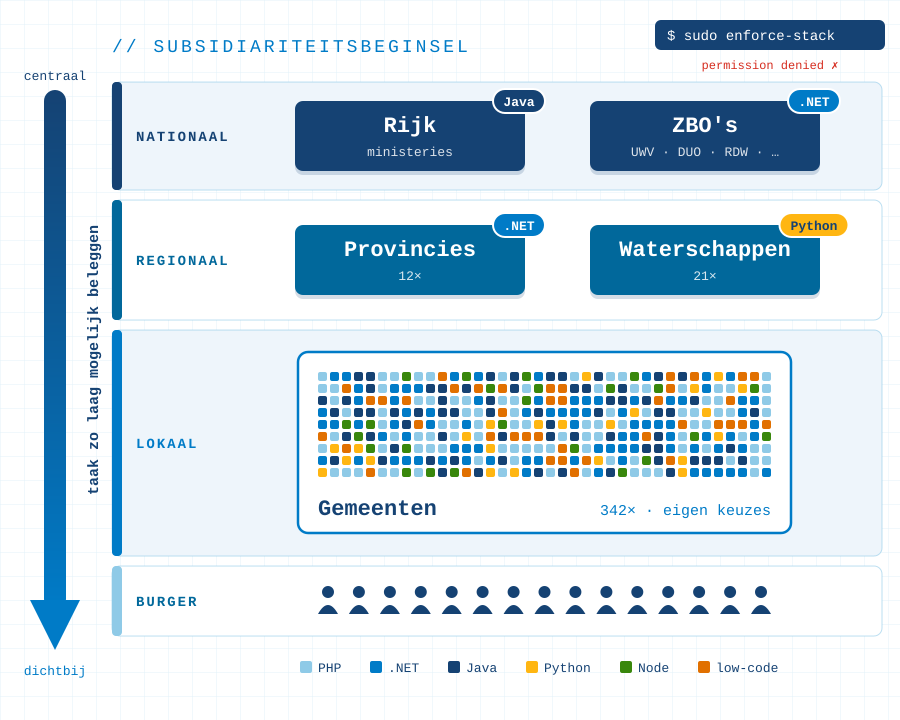
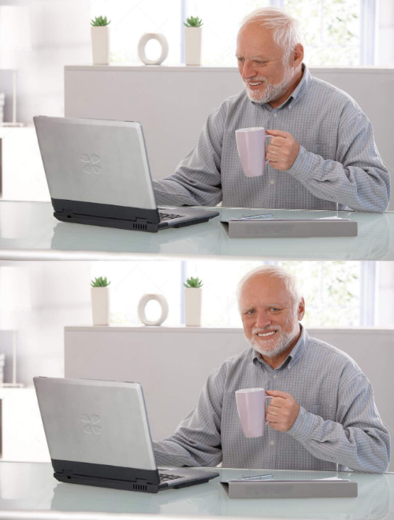
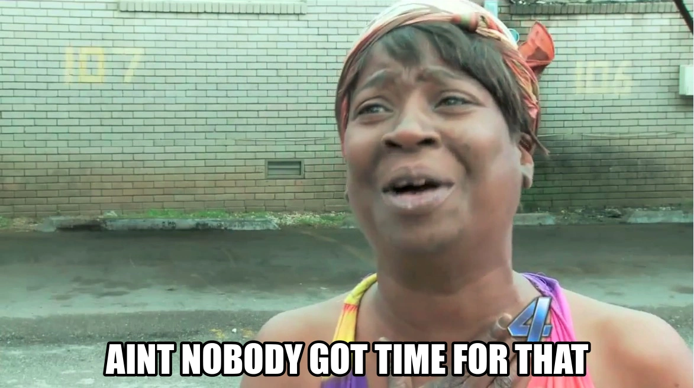

# Standaardiseren == samenwerken

<!-- _class: title invert -->

<ul class="horizontal-list" style="margin-top: 3rem;">
  <li>Tom Ootes</li>
  <li>🐘 <a href="https://social.codefor.nl/@tomootes">@tomootes</a></li>
  <li>Utrecht</li>
  <li>28 oktober 2026</li>
</ul>

<!--

In deze presentatie wil ik jullie graag meenemen in de ervaringen die ik heb
opgedaan tijdens mijn werk afgelopen jaren. Ik begon als developer die wars was
van conventies en linters, het voelde alsof mij iets werd opgelegd terwijl
niemand mij kon uitleggen waarom dat precies zo was.

De afgelopen jaren ben ik standaarden gaan zien als een manier van samenwerken,
van afspraken die je maakt als je bijvoorbeeld een API bouwt of een front-end.
Ik zie het als een manier voor onze overheid om eindelijk wat meer eenduidig te
developen, maar ook als een manier om instructies mee te geven aan LLM's zodat
coding agents niet uit de bocht vliegen. In die zijn worden standaarden steeds
belangrijk.

-->

## whoami?

<!-- _class: invert -->

  <ul>
    <li>Tom Ootes</li>
    <li>Developer.overheid.nl (2023)</li>
    <li>Open Source, Developer Advocate</li>
    <li>Community, outreach</li>
    <li>Muzikant/ muziekliefhebber</li>
  </ul>
  

    
  

<!--
Kort eerst iets over mijzelf.

Ik ben Tom, werk al sinds 2023 aan developer.overheid.nl. Als freelancer
veel verschillende overheidsprojecten gedaan. Vind het mooi om daar aan te
werken omdat we met developer.overheid.nl een gemeenschappelijk platform
hebben om developers op een-duidige manier software te laten bouwen.

Mijn rol is developer advocate wat betekent dat ik me verdiep in wat developers
nodig hebben om bijvoorbeeld compliant te kunnen worden aan een standaard.

-->

## Agenda

<!-- _class: invert -->

- developer.overheid.nl
- mijn ervaringen met standaarden
  - ADR
  - Publiccode.yml / solving Open Source catalogs

## COVID-19: bron- en contactonderzoek software

<!-- _class: invert -->

- ⚕️ Ministerie van Volksgezondheid, Welzijn en Sport
- 😷 Bron- en contactonderzoek [COVID-19]
- 📝 Vragenlijsten en formulieren
- 📋 Informeren/ statistieken

<!--
Voordat ik bij developer.overheid.nl begon, werkte ik als freelancer bij VWS.
Midden in de coronacrisis: software voor het bron- en contactonderzoek,
vragenlijsten en formulieren, en het informeren van burgers met statistieken.
-->

## Hoe het er aan toe ging

<!-- _class: title-left invert -->

- Veel beleidswijzigingen
- Inhouse was iets nieuws
- Elk team zijn eigen stack
- 📖 Geen docs

<!--

Nou waar we toen mee te maken hadden waren veel beleidswijzingen. Het kon zijn dat als we maandagochtend onze werkdag begonnenn dat er dan allerlei paramaters zoals bijvoorbeeld de quarantaineperiode gewijzigd moesten worden. Wij moesten dat dan zo snel mogelijk doorvoeren, dit had trouwens allerlei effecten op hoe de front-end werkte, dus dat moest getest worden, en dan moest het naar productie.

Nog een ding, voor het VWS was het Nog een ding, voor het VWS was het dus iets nieuws om zelf software te bouwen. Dus de organisatie moest er heel erg aan wennen.

Ja, het voelde als developer dus gek om in die context ook te bouwen, omdat er niks vastgelegd was.

-->

## Waarom is er niks centraals?

- Meest logisch?

## Project: developer.overheid.nl

<!-- _class: rainbow -->

<!-- 

Nou nadat mijn project bij min-vws afliep was ik dus heel erg bezig met deze vraag. Dat was het moment waarop ik tegen developer.overheid.nl aanliep. Destijds was het nog een stuk minder volledig dan het nu is, alleen het concept van een gedeeld developer portaal sprak me heel erg aan.

 -->

## Zette me aan het denken

<!-- _class: invert question -->

Hoe maken we de overheid beter op digitaal vlak?

## Het overheidslandschap

<!-- _class: invert title-left -->

Eilandjes > 1 ecosysteem

<!-- Tijdens mijn werk kwam ik erachter dat overheidsorganisaties eerder functioneren
 als aparte eilandjes dan als een ecosysteem. Elke organisatie waarmee ik praatte 
 hadden en andere tech-stack. -->

## 👥 Dezelfde uitvoeringstaken!

<!-- _class: list-text-small -->

- Woo: openbaarmaking & Woo-verzoeken
- Formulieren & aanvragen
- Inloggen met DigiD / eHerkenning
- Toegankelijke websites (WCAG)
- Meldingen openbare ruimte

<!-- 
Echter! Veel taken die organisaties hebben zijn hetzelfde. Neem bijvoorbeeld de WOO: dat geldt voor ministeries, gemeentes, provincies, waterschappen en ZBO's (UWV, DUO, RDW).

Dus zou het logisch zijn om de software die je bouwt voor deze taken te delen met elkaar, en er samen aan te ontwikkelen. 

ZOU JE DENKEN!

 -->

<!-- Insert image of overheids-islands? -->

## Ambities, hogere kwaliteit

<!-- _class: invert title-left -->

- Accessibility (WCAG)
- Security
- Data delen (API's, Informatiemodellen)
- AI(-skills)?

<!-- 

- Hoe zorgen we er als devs voor dat we op dezelfde manier gaan werken?
- Hoe convergeren we dus werkwijzen?
- Onze overheid heeft een enorme ambities als het gaat om de kwaliteit die software zou moeten hebben. Alleen zie je dat die ambities moeten wijken als de deadline in zicht komt. Het vereist best wat specialistische kennis 

 -->

 ## Gedecentraliseerde overheid

<!-- _class: list-text-small title-small -->

- Macht is verdeeld
- Uitvoering bij kleinste organisatie
- Techniek niet op te leggen

<!-- 

Onze overheid heeft haar macht heel goed verdeeld. De ene uitvoerende organisatie heeft in feite weinig te zeggen over de andere. Dit is heel nuttig want het zorgt voor stabiliteit, alleen kan je dus geen technische werkwijze afdwingen!

-->

## Conclusie; iedereen is eigenwijs

Je kan Nederlandse overheidsorganisaties heel moeilijk op leggen hoe te werken

<!-- 

-->

## Nieuwe strategie: **extreem goede** tooling bouwen!

- Nieuwe strategie
- Tooling moet meerwaarde bieden, niet alleen iets opleggen
- Maar door de tooling moet je wel direct compliant zijn

<!-- Dus wat hebben we nodig? -->

## Antwoorden

<!-- _class: invert answers -->

- Open source samenwerken
- Open standaarden
- Gedeelde services (code.overheid.nl)

 <!--  -->

## Mijn doel

Als ik nadacht over mijn werk als developer dan ging het al snel over een grotere
 vraag. Hoe maken we dit beter voor de hele overheid?

## Iedereen doet wat ie wil!

<!-- _class: invert -->

## Over developer.overheid.nl

<!-- 
EIndelijk over developer.overheid.nl; wij zijn een bottom up geinspireerd developer platoform, open source. ETc.

 -->

### Pas toe leg uit - lijst

Hier ga ik iets vertellen over de PTOLU lijst.

## Over de API Design Rules

Dit is een open standaard die we samen met de gehele overheid vormgeven. Het
beschrijft hoe een een HTTP/REST API er uit zou moeten zien, hoe de endpoints
zouden moeten functioneren.

Iedereen die er iets van vind kan een PR inschieten.

## Een les die we leerden

Van PROD naar Open API Specification

<!--

Ooit onderhielden we een API validator. Een complexe tool die live naar de endpoints van een API ging kijken of deze wel compliant was. 

 -->

## Wat voor problemen het kan oplossen

De Nederlandse overheid is een gedecentraliseerd geheel waarbij elke organisatie
zelf verantwoordelijk is voor de uitvoering van haar IT. Ik zie dit op korte
termijn ook niet snel veranderen.

## Dus hoe krijgen we die standaaarden aan de man?

Goede tooling aanbieden! Dit is ook onze filosofie bij developer.overheid.nl.

## API Design Rules

Screenshot van de RESPEC van de API Design Rules.

Binnen de overheid hebben we tal van standaarden die verschrikkelijk goed
gedocumenteerd zijn.

## De rules!

NOICE TABLE WITH:

technical rules // and functional rules

## Focus op CI/CD

Onze tools kan je uiteraard in je Github/ Gitlab/ Forgejo pipeline hangen.

En ik weet wel, als developer ben je vooral dingen aan het oplossen. Developers
zijn niet van nature mensen die de documentatie erbij pakken en er even goed
voor gaan zitten.

## AINT NOBODY GOT TIME FOR THAT

## Tooling!

Maar inmiddels hebben we prachtige tooling. Ik moedig iedereen aan o

## Bedankt!

Vragen?

🐘 [@tomootes](https://social.codefor.nl/@tomootes) 📬 t.ootes@geonovum.nl
