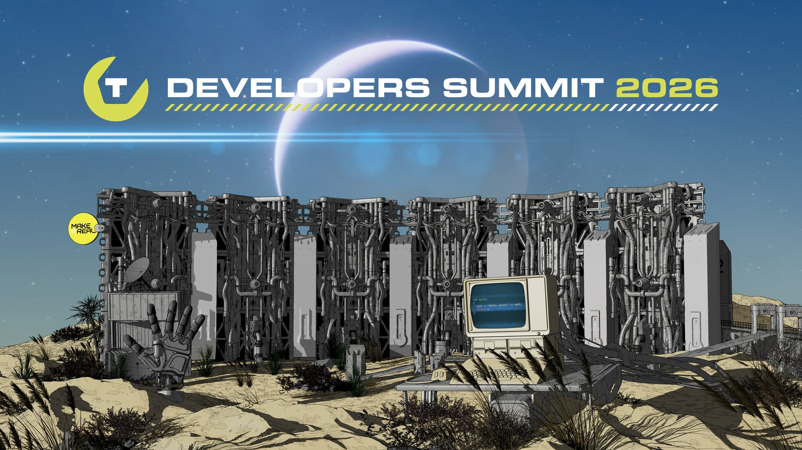
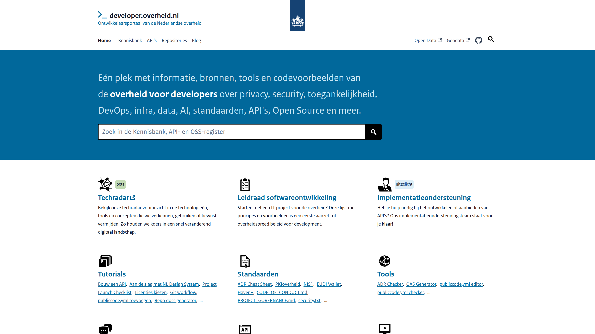
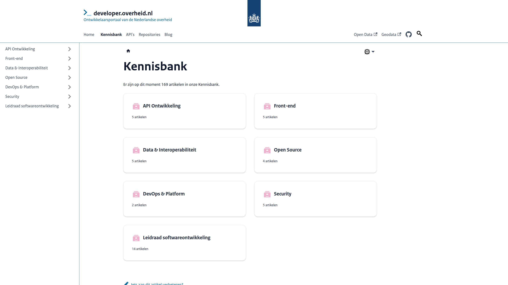
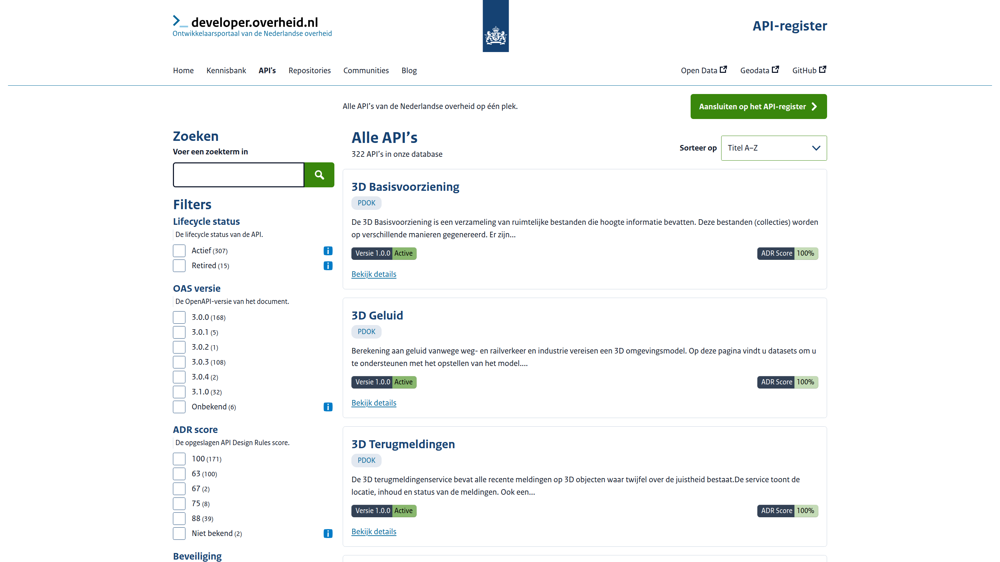
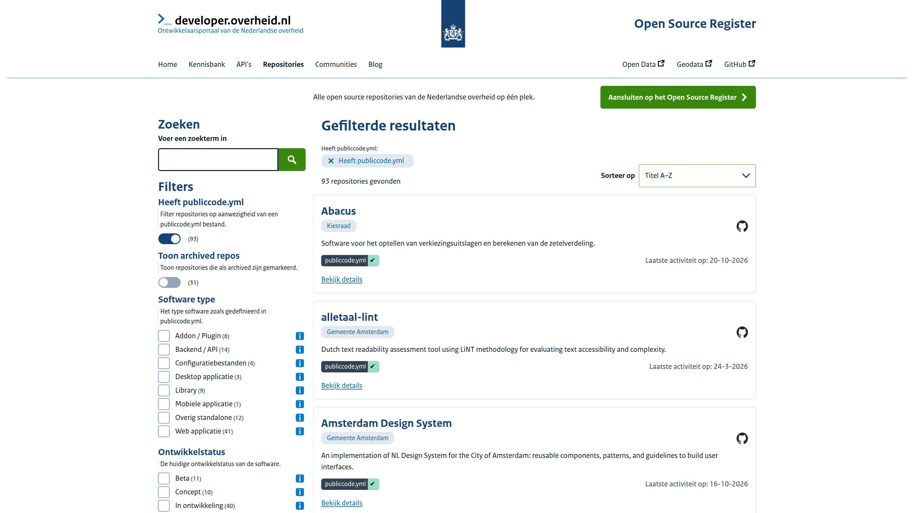
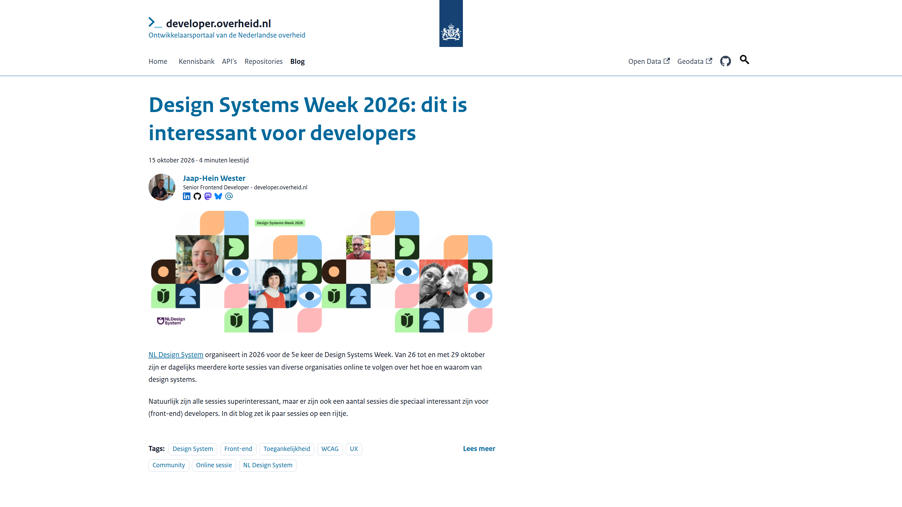
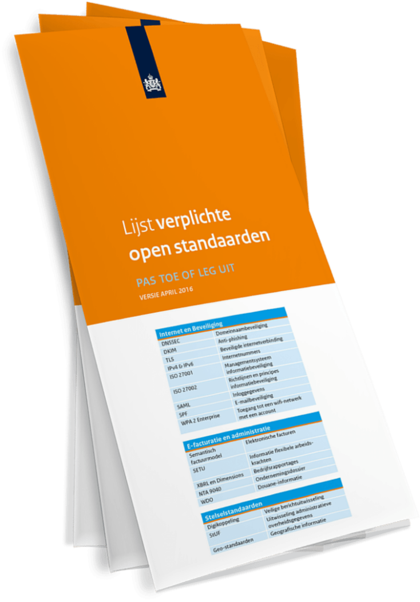
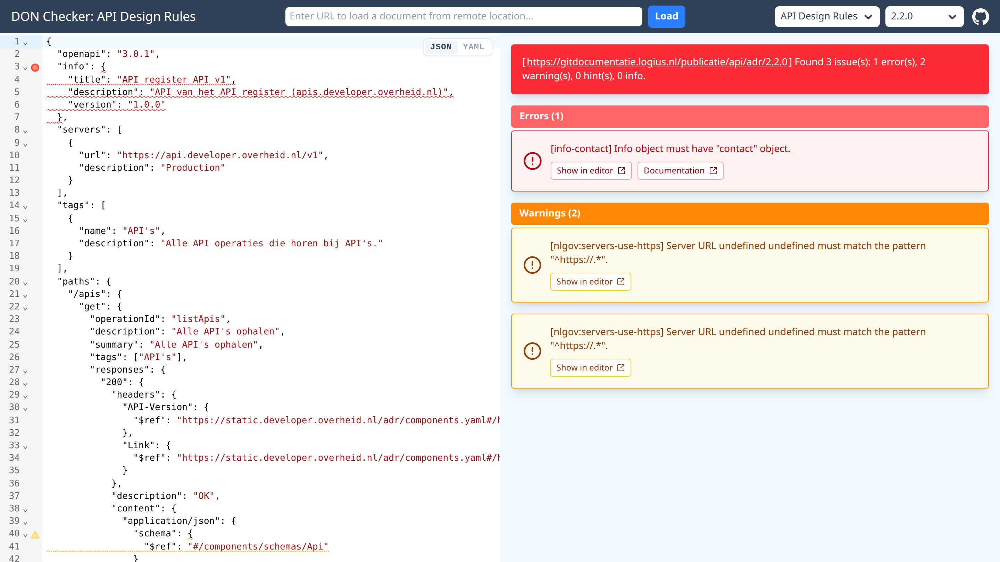
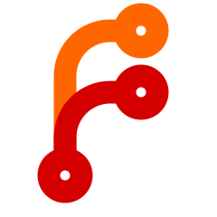

<!-- _header: "" -->
<!-- _footer: "" -->
<!-- _paginate: false -->

# <span class="prompt">&gt;</span> standaardiseren <span class="eq">==</span> samenwerken

<!-- _class: title invert title-terminal -->

<ul class="horizontal-list">
  <li>Tom Ootes</li>
  <li>🐘 <a href="https://social.codefor.nl/@tomootes">@tomootes</a></li>
  <li>Tweakers dev summit</li>
  <li>De Fabrique, Utrecht</li>
  <li>28 oktober 2026</li>
</ul>

<!--

- Leuk dat ik hier mag vertellen over DON
- Grapje dat ik hier aan de overkant van het kanaal woon
- Vertellen over alle inzichten van DON afgelopen jaren
- Mooie tools die hieruit voort zijn gekomen

De afgelopen jaren ben ik standaarden gaan zien als een manier van samenwerken,
van afspraken die je maakt als je bijvoorbeeld een API bouwt of een front-end.
Ik zie het als een manier voor onze overheid om eindelijk wat meer eenduidig te
developen, maar ook als een manier om instructies mee te geven aan LLM's zodat
coding agents niet uit de bocht vliegen. In die zijn worden standaarden steeds
belangrijk.

-->

## whoami?

<!-- _class: invert -->

<div class="two-columns">
  <ul>
    <li>Tom Ootes</li>
    <li>Developer.overheid.nl (2023)</li>
    <li>Open Source, Developer Advocate</li>
    <li>Community, outreach</li>
    <li>Muzikant/ muziekliefhebber</li>
  </ul>
  <div>
    
  </div>
</div>

<!--
Kort eerst iets over mijzelf.

Ik ben Tom, werk al sinds 2023 aan developer.overheid.nl. Als freelancer
veel verschillende overheidsprojecten gedaan. Vind het mooi om daar aan te
werken omdat we met developer.overheid.nl een gemeenschappelijk platform
hebben om developers op een-duidige manier software te laten bouwen.

Mijn rol is developer advocate wat betekent dat ik me verdiep in wat developers
nodig hebben om bijvoorbeeld compliant te kunnen worden aan een standaard.

-->

## Agenda

<!-- _class: invert -->

1. Over developer.overheid.nl
1. Mijn verhaal: COVID-19 bij VWS
1. Het overheidslandschap: eilandjes maar gedeelde taken
1. Strategie: open source, open standaarden en centrale diensten
1. Standaarden: API Desing Rules
1. Open Source: Publiccode.yml
1. Centrale dienst: Code.overheid.nl
1. Oproep

<!--
Even wat we gaan doen: eerst kort wat developer.overheid.nl is. Dan hoe ik er
terechtkwam, via mijn werk bij VWS tijdens corona. Daarna het overheidslandschap
en waarom standaardiseren zo lastig is. En tot slot onze strategie: tooling die
zo goed is dat je vanzelf compliant wordt.
-->

##

<!-- _class: page-image-only -->
<!-- _header: "" -->
<!-- _footer: "" -->
<!-- _paginate: false -->



<!--
Eerst kort wat developer.overheid.nl is, want daar kom ik vandaan.

Het is een developerportaal voor de hele overheid. Denk aan de developer-docs die je kent van grote platforms, alleen dan voor honderden organisaties tegelijk.

- Een API-register: welke API's zijn er bij de overheid, met documentatie, en we checken of ze voldoen aan de API Design Rules.
- Een open source-register op basis van publiccode.yml: welke software is er al, wie gebruikt het, zodat je niet opnieuw het wiel uitvindt.
- Een kennisbank over API's, open source en front-end.

En we zijn zelf ook open source: alles staat op GitHub, en iedereen mag meedoen.

We leggen niets op. We proberen het makkelijk te maken. Daar gaat deze talk over.
-->

## Kennisbank

<!-- _class: page-image-only -->
<!-- _header: "" -->
<!-- _footer: "" -->
<!-- _paginate: false -->



<!--
De kennisbank: artikelen over API-ontwikkeling, front-end, data, open source, DevOps en security. Op dit moment 169 artikelen.
-->

## API-register

<!-- _class: page-image-only -->
<!-- _header: "" -->
<!-- _footer: "" -->
<!-- _paginate: false -->



<!--
Het API-register: alle API's van de overheid op één plek, 322 op dit moment. Elke API krijgt een ADR-score: hoe goed volgt hij de API Design Rules. Daar kom ik straks op terug.
-->

## Open Source Register

<!-- _class: page-image-only -->
<!-- _header: "" -->
<!-- _footer: "" -->
<!-- _paginate: false -->



<!--
Het Open Source Register: open source repositories van de overheid, op basis van publiccode.yml. Zo zie je welke software er al is en wie er nog meer aan werkt.
-->

## Blog

<!-- _class: page-image-only -->
<!-- _header: "" -->
<!-- _footer: "" -->
<!-- _paginate: false -->



<!--
En een blog, met technische posts van ons en van andere overheidsteams.
-->

## COVID-19: front-end dev VWS

<!-- _class: invert title-left -->

- Ministerie van Volksgezondheid, Welzijn en Sport
- Bron- en contactonderzoek
- Vragenlijsten en formulieren
- Informeren/ statistieken


<!--
Voordat ik bij developer.overheid.nl begon, werkte ik als freelancer bij VWS.
Midden in de coronacrisis: software voor het bron- en contactonderzoek,
vragenlijsten en formulieren, en het informeren van burgers met statistieken.
-->

## Hoe het er aan toe ging

<!-- _class: title-left invert -->

- Veel beleidswijzigingen
- Inhouse was iets nieuws
- Elk team zijn eigen stack
- 📖 Geen interne docs


<!--

Nou waar we toen mee te maken hadden waren veel beleidswijzingen. Het kon zijn dat als we maandagochtend onze werkdag begonnenn dat er dan allerlei paramaters zoals bijvoorbeeld de quarantaineperiode gewijzigd moesten worden. Wij moesten dat dan zo snel mogelijk doorvoeren, dit had trouwens allerlei effecten op hoe de front-end werkte, dus dat moest getest worden, en dan moest het naar productie.

Nog een ding, voor het VWS was het Nog een ding, voor het VWS was het dus iets nieuws om zelf software te bouwen. Dus de organisatie moest er heel erg aan wennen.

Ja, het voelde als developer dus gek om in die context ook te bouwen, omdat er niks vastgelegd was.

-->

## Waarom is er niks centraals?

<!-- _class: title-left invert -->


## developer.overheid.nl

<!-- _class: rainbow -->

<!--

Nou nadat mijn project bij min-vws afliep was ik dus heel erg bezig met deze vraag. Dat was het moment waarop ik tegen developer.overheid.nl aanliep. Destijds was het nog een stuk minder volledig dan het nu is, alleen het concept van een gedeeld developer portaal sprak me heel erg aan.

 -->

## De vraag

<!-- _class: invert question -->

Hoe maken we de overheid beter op digitaal vlak?

## Het overheidslandschap

<!-- _class: invert title-left -->

Eilandjes > 1 ecosysteem

<!--

Tijdens mijn werk kwam ik erachter dat overheidsorganisaties eerder functioneren
 als aparte eilandjes dan als een ecosysteem. Elke organisatie waarmee ik praatte
 hadden en andere tech-stack.

 -->

## 👥 Dezelfde uitvoeringstaken!

<!-- _class: list-text-small -->

- Woo: openbaarmaking & Woo-verzoeken
- Formulieren & aanvragen
- Inloggen met DigiD / eHerkenning
- Security (HTTPS, etc.)
- Toegankelijke websites (WCAG)

<!--
Echter! Veel taken die organisaties hebben zijn hetzelfde. Neem bijvoorbeeld de WOO: dat geldt voor ministeries, gemeentes, provincies, waterschappen en ZBO's (UWV, DUO, RDW).

Dus zou het logisch zijn om de software die je bouwt voor deze taken te delen met elkaar, en er samen aan te ontwikkelen.

ZOU JE DENKEN!

 -->

<!-- Insert image of overheids-islands? -->

## Pas toe of leg uit

<!-- _class: list-text-small -->



- Lijst met ~40 open standaarden (Forum Standaardisatie)
- Verplicht bij ICT-inkoop vanaf €50k
- Niet toepassen? Uitleggen in je jaarverslag
- HTTPS/HSTS, DNSSEC, WCAG, OpenAPI, REST API Design Rules

<!--

Er ís wel een manier waarop de overheid standaarden een beetje afdwingt: de "pas toe of leg uit"-lijst van het Forum Standaardisatie. Een lijst van zo'n 40 open standaarden. Koop je als overheidsorganisatie ICT in boven de 50.000 euro, dan moet je die standaarden toepassen. Doe je dat niet, dan moet je uitleggen waarom, in je jaarverslag.

Op de lijst staan dingen die jullie kennen: HTTPS en HSTS, DNSSEC, WCAG voor toegankelijkheid, OpenAPI, en de REST API Design Rules, waar ik het straks uitgebreid over ga hebben.

Maar: een lijst maakt nog niet dat het ook gebeurt. Bruggetje naar tooling.

-->

## Gedecentraliseerde overheid

<!-- _class: list-text-small title-small invert title-left -->


- Macht is verdeeld
- Uitvoering bij kleinste organisatie
- Techniek niet op te leggen

<!--

Onze overheid heeft haar macht heel goed verdeeld. De ene uitvoerende organisatie heeft in feite weinig te zeggen over de andere. Dit is heel nuttig want het zorgt voor stabiliteit, alleen kan je dus geen technische werkwijze afdwingen!

-->

## Conclusie: iedereen heeft een eigen strategie

<!-- _class: invert -->


<!--

-->

## Het antwoord: **extreem bruikbare** tooling bouwen!

Met echt nuttig is in de praktijk

<!--

- Dit is de strategie die we sindsdien gevolgd hebben
- We kunnen niemand echt iets opleggen
- Daarom tooling bouwen die nuttig is voor developers
- Een bepaalde use-case goed ondersteunen
- Dit is ook echt de kern van de filosofie van developer.overheid.nl

 -->

## Pijlers

<!-- _class: invert pillars -->

- 1:Open source samenwerken `NL-Design-System` `Haven (k8s)`
- 2:Open standaarden `API Design Rules` `HTTPS` `Digitoegankelijk`
- 3:Gedeelde services `code.overheid.nl` `developer.overheid.nl`

 <!--  -->

## Pijler 1: Open Source samenwerken

- Cultuurverandering
- Vanzelfspreken voor developers

- Vaak geen ruimte

## Vind het wiel niet opnieuw uit

<!-- _class: invert -->


## Repo open source klaarmaken, met een skill

<!-- _class: invert code-terminal title-top -->

<style scoped>section { --code-terminal-title: "tom@developer.overheid.nl: ~/mijn-project"; }</style>

<pre class="terminal"><span class="user">tom@developer.overheid.nl</span>:<span class="path">~/mijn-project</span>$ claude plugin marketplace add developer-overheid-nl/skills-marketplace
<span class="user">tom@developer.overheid.nl</span>:<span class="path">~/mijn-project</span>$ claude plugin install developer-overheid-open-source-repo@overheid-plugins
<span class="ok">✔</span> Installed developer-overheid-open-source-repo

<span class="user">tom@developer.overheid.nl</span>:<span class="path">~/mijn-project</span>$ claude
<span class="rule">❯ voeg een correcte licentie toe :)</span>

<span class="ok">●</span> <span class="rule">Skill</span>(developer-overheid-open-source-repo:<span class="ok">open-source-repo</span>)
  <span class="dim">⎿ Successfully loaded skill · 16 tools allowed</span>

<span class="ok">●</span> <span class="dim">Ran 4 shell commands</span>

<span class="ok">●</span> Nu de licentie op zijn plek zetten en de repository REUSE-compliant maken.

<span class="ok">●</span> <span class="rule">Created</span> LICENSE.md <span class="ok">(+311</span> <span class="err">-0)</span>
  <span class="dim">⎿</span> # Licence
     Copyright © developer.overheid.nl.
     Licensed under the <span class="ok">EUPL</span>.
     This project follows the <span class="link">REUSE specification</span>.</pre>

<!--

Mooi, zo'n catalogus. Maar dan moet je repo er wel in passen: een README, een licentie, een SECURITY.md, en een publiccode.yml zodat de catalogus weet wat je project is.

Daarvoor hebben we de repo-docs-generator: een webtool én CLI die al die bestanden genereert uit één input.json, op basis van gedeelde templates.

En omdat niemand graag een input.json invult, zit er een Agent Skill bij. Je vraagt je AI-assistent gewoon "voeg een correcte licentie toe", en de skill laadt vanzelf. Die leest je repo uit, vult de input in en draait de generator. Belangrijk: de agent schrijft de bestanden níet zelf, de templates blijven de bron van waarheid. Zo krijg je geen gehallucineerde publiccode.yml.

Paved road: de makkelijkste weg is meteen de goede.

-->

## Pijler 2: Open Standaarden & tooling

## API Design Rules

<!-- _class: list-text-small grid-paper invert title-left title-small -->


- Open Source, iedereen kan meedoen
- HTTP/REST
- Open API Spec
- Architectuur-standaard
- Voorkomt discussies
- Ook nuttig voor bedrijven!

## Voorbeeld Open API Spec (Swagger)

<!-- _class: invert code-editor -->

```json
{
  "openapi": "3.1.0",
  "info": {
    "title": "OSS-register API v1",
    "version": "1.0.0",
    "contact": {
      "email": "developer.overheid@geonovum.nl",
      "name": "Team developer.overheid.nl",
      "url": "https://github.com/developer-overheid-nl/don-oss-register/issues"
    },
    "description": "API to access the OSS register of developer.overheid.nl..."
  },
  "servers": [
    {
      "description": "Production",
      "url": "https://api.developer.overheid.nl/oss-register/v1"
    },
    ...
  ],
  "tags": [
    {
      "name": "Repositories",
      "description": "Endpoints for listing and managing repositories."
    },
    ...
  ],
  "paths": {
    "/git-organisations": {...},
    "/repositories/filters": {...},
    "/repositories": {...},
    "/repositories/_search": {...},
    "/repositories/{id}": {...},
    "/organisations": {...},
  }
}
```

## OAS-Checker

<!-- _class: invert  -->



## OAS-Checker in je terminal (ook CI/CD)

<!-- _class: invert code-terminal -->

<pre class="terminal"><span class="user">tom@developer.overheid.nl</span>:<span class="path">~/oss-register</span>$ npx @developer-overheid-nl/don-checker validate \
    --standard adr --input ./openapi.json
<span class="dim">Ruleset:</span> adr@2.2.0
<span class="dim">Applied rulesets:</span> <span class="link">https://gitdocumentatie.logius.nl/publicatie/api/adr/2.2.0</span>
<span class="dim">Diagnostics:</span> 3 (<span class="err">errors 3</span>, warnings 0, info 0, hints 0)

<span class="err">Errors (3)</span>
  1. <span class="rule">nlgov:include-major-version-in-uri</span>
     <span class="dim">message:</span> Include the major version number in the URI.
     <span class="dim">path:</span>    ["servers","0","url"]
     <span class="dim">docs:</span>    <span class="link">https://developer.overheid.nl/kennisbank/apis/api-design-rules/hoe-te-voldoen/uri-version</span>
  2. <span class="rule">nlgov:paths-kebab-case</span>
     <span class="dim">message:</span> /waterKeringen is not kebab-case.
     <span class="dim">path:</span>    ["paths","/waterKeringen"]
  3. <span class="rule">nlgov:missing-header</span>
     <span class="dim">message:</span> Return the full version number in a response header.
     <span class="dim">path:</span>    ["paths","/waterKeringen","get","responses","200"]
     <span class="dim">docs:</span>    <span class="link">https://developer.overheid.nl/kennisbank/apis/api-design-rules/hoe-te-voldoen/version-header</span>
    </pre>

<!--

Dezelfde checker draait ook gewoon in je terminal, zonder installatie: npx en gaan. Je geeft aan tegen welke standaard je wil checken, hier de API Design Rules, en je OAS-bestand of een URL.

Je krijgt per overtreding de regel, waar in je spec het zit, en een link naar de kennisbank met uitleg hoe je eraan voldoet.

En belangrijk: bij errors is de exit code 1. Dus je hangt hem zo in je pipeline en je merge request wordt rood. Met --fail-on kun je zelf kiezen of warnings ook al falen.

-->

<!-- ## Een les die we leerden

Van PROD naar Open API Specification

<!--

Ooit onderhielden we een API validator. Een complexe tool die live naar de endpoints van een API ging kijken of deze wel compliant was.

-->

## 3: Overheidsbrede services

- Code.overheid.nl
- Gestandaardiseerde K8s clusters
- Templates/ Golden paths per programmeertaal

## code.overheid.nl

<!-- _class:  -->

- Soevereiniteit
- 1 plek voor development
- Netwerkeffect!



<!--

En dan pijler 3: gedeelde services. Het mooiste voorbeeld: code.overheid.nl, sinds april 2026 live als soft launch.

Een eigen forge voor de hele overheid, gebouwd op Forgejo: de community-fork van Gitea, GPLv3+, beheerd door de non-profit Codeberg e.V. Geen enterprise-tier, geen upsell, geen vendor lock-in.

Het draait op eigen overheidsinfrastructuur bij SSC-ICT en is gratis voor elke overheidsorganisatie. Een initiatief van het OSPO van BZK, samen met SSC-ICT, Opensourcewerken en developer.overheid.nl.

Voor jou als developer voelt het gewoon als GitHub: git push, pull requests, issues, code review. De Kiesraad zet er al code op, zoals Abacus.

Toegang is nog beperkt: aanmelden via codeplatform@rijksoverheid.nl.

-->

## Bedankt!

<!-- _class: invert -->

<style scoped>
.meetup { position: absolute; right: 80px; top: 50%; transform: translateY(-50%); width: 340px; text-align: center; }
.meetup img { display: block; width: 300px; margin: 0 auto 16px; border-radius: 12px; }
.meetup p { margin: 0; font-size: 0.7em; line-height: 1.3; }
</style>

Vragen?

- 🐘 [@tomootes](https://social.codefor.nl/@tomootes)
- 📬 tom@ootes.io

<div class="meetup">
  
  <p><strong>Schrijf je in voor onze meetup!</strong><br>Locatie: Utrecht</p>
</div>

<!--

Scan de QR-code om je in te schrijven voor de developer.overheid.nl meetup: https://opensourcewerken.nl/events/view/8dfe1365-3742-4832-8359-f2efed31126a/developeroverheidnl-meetup-samenbeterbouwen

-->
